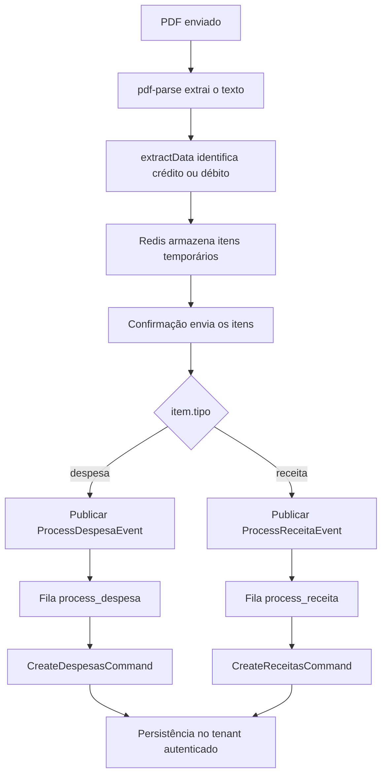

# Extração de créditos de extrato bancário como receitas

> Status: referência atual. Processo implementado e validado em 16/11/2026.

## Objetivo

O processo estende a extração de extratos bancários do Bradesco para retornar tanto débitos quanto créditos. Cada lançamento da coluna `Crédito (R$)` é classificado como `receita`; na confirmação dos dados temporários, despesas são enviadas para `ProcessDespesaEvent` e receitas para `ProcessReceitaEvent`, que executa `CreateReceitasCommand` pelo `CommandBus`.

Após o upload, o frontend redireciona para `/despesas/temporarias/:id`. A revisão usa o campo `tipo` para apresentar e validar os campos próprios de cada lançamento: despesas exigem vencimento, pagamento e parcela; receitas exigem recebimento e não exibem pagamento ou parcela.

O PDF usado como referência é apenas um artefato local de validação e contém dados pessoais. Ele não deve ser copiado para o repositório. Testes automatizados devem usar texto sintético ou sanitizado.

## Comportamento esperado do modelo de extrato

O modelo possui as colunas `Data`, `Histórico`, `Docto.`, `Crédito (R$)`, `Débito (R$)` e `Saldo (R$)`. A extração deve:

- manter os débitos já extraídos como `tipo: "despesa"`;
- transformar cada valor positivo da coluna de crédito em `tipo: "receita"`;
- usar a data da linha do extrato como `recebimento` da receita;
- combinar as linhas do histórico na descrição, preservando o comportamento atual para descrições quebradas em mais de uma linha;
- ignorar cabeçalhos, rodapés e a linha `Total`;
- converter valores brasileiros para `number` sem perda de centavos;
- não confiar em `tenant_id` recebido no item: o contexto do tenant deve continuar vindo da sessão autenticada.

No documento de referência, os créditos individuais são:

`0,18`, `0,02`, `0,03`, `0,01`, `0,01`, `2.519,00`, `0,01`, `0,01` e `0,01`.

Critério de controle para esse modelo: nove receitas, totalizando `R$ 2.519,28`. O total impresso no rodapé não pode gerar uma décima receita.

## Contrato dos itens extraídos

`extractData` retorna uma união discriminada por `tipo`:

| Campo          | Despesa     | Receita     | Regra                                            |
| -------------- | ----------- | ----------- | ------------------------------------------------ |
| `tipo`         | `"despesa"` | `"receita"` | Define o evento publicado.                       |
| `descricao`    | obrigatório | obrigatório | Histórico normalizado e não vazio.               |
| `valor`        | obrigatório | obrigatório | Número finito, positivo para o extrato bancário. |
| `vencimento`   | obrigatório | ausente     | Data ISO da despesa.                             |
| `recebimento`  | ausente     | obrigatório | Data ISO do crédito no extrato.                  |
| `categoria_id` | obrigatório | obrigatório | Categoria padrão definida para a extração.       |
| `status_id`    | obrigatório | obrigatório | Status padrão definido para a extração.          |
| `parcela_id`   | obrigatório | ausente     | Mantido somente para despesa.                    |
| `pagamento_id` | obrigatório | ausente     | Mantido somente para despesa.                    |

Exemplo sanitizado de receita extraída:

```json
{
  "tipo": "receita",
  "descricao": "TED-TRANSF ELET DISPON REMET.CAIXA ECONOMICA FEDE",
  "valor": 2519,
  "recebimento": "2026-10-19",
  "categoria_id": "<categoria-padrao>",
  "status_id": "<status-padrao>"
}
```

## Fluxo de processamento



### 1. Extração

Em `src/application/utils/extractData.ts`:

1. O contrato de retorno representa despesa ou receita.
2. A direção é calculada pelo saldo anterior e pelos padrões de descrição.
3. `debit` cria uma despesa.
4. `credit` cria uma receita com `recebimento` igual à data corrente do extrato.
5. Direção `unknown`, valor inválido ou descrição ignorada não geram lançamento.

### 2. Publicação condicional

`CreateDataProcessDespesasHandler` valida a união discriminada:

- `tipo: "despesa"`: validar os campos de despesa e publicar `ProcessDespesaEvent`;
- `tipo: "receita"`: validar `descricao`, `valor`, `recebimento`, `categoria_id` e `status_id`, então publicar `ProcessReceitaEvent`;
- qualquer outro tipo ou combinação de campos: responder `BadRequestException` antes de publicar eventos.

O nome histórico do command/handler permanece para evitar alteração de rota e contrato HTTP. Uma renomeação para um processo financeiro genérico fica fora deste escopo.

### 3. Novo evento de receita

`ProcessReceitaEvent` segue o envelope seguro já usado por despesas:

- routing key/fila: `process_receita`;
- payload: `{ context, receita }`;
- `context`: `tenantId`, `userId` e `role`, construído pelo backend autenticado;
- `receita`: somente `descricao`, `valor`, `recebimento`, `categoria_id` e `status_id`.

O item não deve definir o tenant efetivo. O consumidor deve executar o comando dentro de `TenantContextService.runInTransaction`, preservando RLS e o repositório contextual.

### 4. Consumo e cadastro

O `RabbitMQEventBus` conserva o nome do evento/fila no callback registrado por `consume(event)` e encaminha a mensagem ao validador e comando correspondentes:

- `process_despesa` valida `ProcessDespesaPayload` e executa `CreateDespesasCommand`;
- `process_receita` valida `ProcessReceitaPayload` e executa `CreateReceitasCommand`;
- sucesso: `ack` somente após a transação e o comando terminarem;
- payload inválido ou falha de persistência: `nack(message, false, false)`.

O bootstrap registra os dois consumidores. `CreateReceitasHandler` está registrado como provider no `ReceitasModule`; a integração chama `CommandBus.execute(new CreateReceitasCommand(...))`, permitindo que o NestJS CQRS despache para o handler existente.

## Verificação e manutenção

1. Introduzir o tipo discriminado de lançamento e a criação de receitas no extrator — verificar com testes unitários de débitos, créditos, descrições multilinha, datas, centavos, direção desconhecida e linha total.
2. Criar `ProcessReceitaEvent` e exportá-lo pelo índice de eventos — verificar nome da fila e formato do payload em teste unitário.
3. Fazer a publicação condicional no processo temporário — verificar que cada tipo publica a classe de evento correta, mantém o contexto autenticado e rejeita itens inválidos sem publicação parcial.
4. Tornar o consumidor RabbitMQ consciente da fila/evento — verificar consumo das duas filas, comando correto, transação de tenant, `ack` no sucesso e `nack` no erro.
5. Registrar `ProcessReceitaEvent` no bootstrap — verificar que a aplicação inicia os dois consumidores sem erro de handler CQRS ausente.
6. Manter `tipo` e os campos específicos ao revisar e confirmar os lançamentos no frontend — verificar que o redirect abre `/despesas/temporarias/:id` e que o payload misto é aceito pelo handler.
7. Remover o arquivo temporário do upload em qualquer resultado do processamento — verificar sucesso, tipo inválido e falha do provedor de IA.
8. Executar `npm test -- --runInBand` para os testes afetados e `npm run build` — verificar regressão zero no extrator, nos handlers e no barramento.

## Critérios de aceite

- O texto sanitizado equivalente ao PDF de referência gera nove receitas com soma `2519.28`.
- A linha de total não gera lançamento.
- Débitos continuam sendo extraídos e cadastrados como despesas.
- Créditos são publicados somente como `ProcessReceitaEvent` e persistidos por `CreateReceitasHandler`.
- Uma lista mista publica um evento por item e mantém o progresso total da lista.
- O upload bem-sucedido abre a revisão do lote em `/despesas/temporarias/:id`.
- A confirmação preserva `tipo`, envia `recebimento` somente para receitas e não envia `tenant_id` informado pelo cliente.
- O arquivo temporário é removido após sucesso ou erro da extração.
- Nenhum `tenant_id` enviado pelo cliente altera o tenant da operação.
- Mensagem inválida não é confirmada no RabbitMQ.

## Fora de escopo

- Alterar o endpoint `POST /despesas/temporias` ou corrigir seu nome nesta entrega.
- Renomear o command/handler histórico de processamento de despesas.
- Persistir ou versionar o PDF real usado como referência.
- Criar deduplicação/idempotência de lançamentos já importados.

## Decisão adotada

- Receitas importadas recebem `statusEnum.aberto`, preservando o padrão atual da extração e sem exigir mudança de schema ou configuração.
